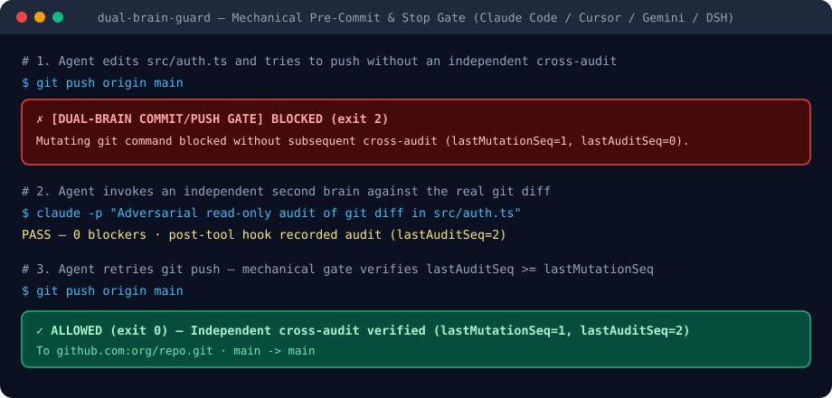

# Dual-Brain Guard (`@franco/dual-brain-guard`)

[](https://github.com/JavierFrancoLeal/dual-brain-guard/actions/workflows/ci.yml)
[](./LICENSE)

**Harness-agnostic mechanical Dual-Brain cross-audit guard for AI coding agents.**  
*By [Javier Franco](https://github.com/JavierFrancoLeal) · `v1.0.0` · Zero External Dependencies · Apache-2.0*

> **Prompt-only review rules get skipped.** Dual-Brain Guard mechanically blocks `git commit`, `git push`, destructive git operations, and unaudited turn completion until an independent second brain audits the real diff *after* your last edit.  
> 📖 **Read the field-notes essay:** [Why Single-Agent Code Reviews Fail](./docs/ESSAY_WHY_SINGLE_AGENT_REVIEWS_FAIL.md)



---

## Works With Every Major AI Coding Harness

| Harness | Enforcement Mode | Adapter |
| :--- | :--- | :--- |
| **Claude Code** | **Mechanical** (`PreToolUse` / `PostToolUse` / `Stop`, exit `2` blocks) | [`src/adapters/claude-code.hooks.json`](./src/adapters/claude-code.hooks.json) |
| **Gemini CLI** | **Mechanical** (`BeforeTool` / `AfterTool` / `AfterAgent`, exit `2` blocks) | [`src/adapters/gemini-cli.hooks.json`](./src/adapters/gemini-cli.hooks.json) |
| **DeepSeek Harness (DSH)** | **Mechanical** (private `WeakMap<Agent, State>` host adapter) | [`src/adapters/dsh.mjs`](./src/adapters/dsh.mjs) |
| **Cursor / Any MCP Host** | **Advisory state & commit-check** via stdio MCP server (`dual-brain-mcp`) | [`src/mcp-server.mjs`](./src/mcp-server.mjs) |

---

## Battle-Tested Mechanical Guarantees

- **Evasive git protection:** catches `git --no-pager commit`, `git -C repo push`, `git branch -f -D`, `git remote -v add`, `git reset`, `gh pr merge` — while allowing read-only `git status`, `git diff`, `git log`, `git tag -l`.
- **Anti-spoofing audit detection:** rejects `--help`, `--version`, backgrounded `&` commands, and false-green error strings (`isError: false` with `"failed to launch"`).
- **Edit ≠ Audit:** delegating an edit to a second brain advances `lastMutationSeq`, never `lastAuditSeq`.
- **Non-sticky per-turn opt-out:** explicit user opt-outs (`skip audit`, `solo mode`) apply *only* to the current turn and reset automatically on the next turn.
- **Anti-recursion & bounded fail-safe:** yields inside subagents / `DUAL_BRAIN_ORIGIN=auditor`, caps stop-gate steers (`2/turn`), and yields cleanly after 2 consecutive auditor launch failures.

---

## Quick Start (Zero Dependencies, Node `>= 18`)

```bash
git clone https://github.com/JavierFrancoLeal/dual-brain-guard.git
cd dual-brain-guard
npm test
```

### Use as a Hook Runner (Claude Code / Gemini CLI / Antigravity)
Copy [`src/adapters/claude-code.hooks.json`](./src/adapters/claude-code.hooks.json) or [`src/adapters/gemini-cli.hooks.json`](./src/adapters/gemini-cli.hooks.json) into your settings, or run directly:
```bash
echo '{"tool_name":"Bash","tool_input":{"command":"git push origin main"}}' | node src/cli.mjs pre-tool
```

### Use as a Stdio MCP Server (Cursor / Claude Code / Any MCP Host)
```json
{
  "mcpServers": {
    "dual-brain-guard": {
      "command": "node",
      "args": ["/path/to/dual-brain-guard/src/mcp-server.mjs"]
    }
  }
}
```

---

## Open-Source Agent Engineering Trilogy

| Flagship | Role | Status |
| :--- | :--- | :--- |
| **[`casebook`](https://github.com/JavierFrancoLeal/casebook)** | Bounded-entropy 4-tier memory, Open Symptoms Radar & executable oracle | **`v1.0.0` Live** |
| **[`dual-brain-guard`](https://github.com/JavierFrancoLeal/dual-brain-guard)** | Harness-agnostic mechanical cross-model verification (`CLI + MCP + hooks`) | **`v1.0.0` Live** |
| **`autonomy-ladder`** | Evidence-based Traffic-Light autonomy grader (`🟢 / ⚑ / 🟡 / 🔴`) | Next (Phase C) |

---

## License

Apache License 2.0 — see [LICENSE](./LICENSE).
